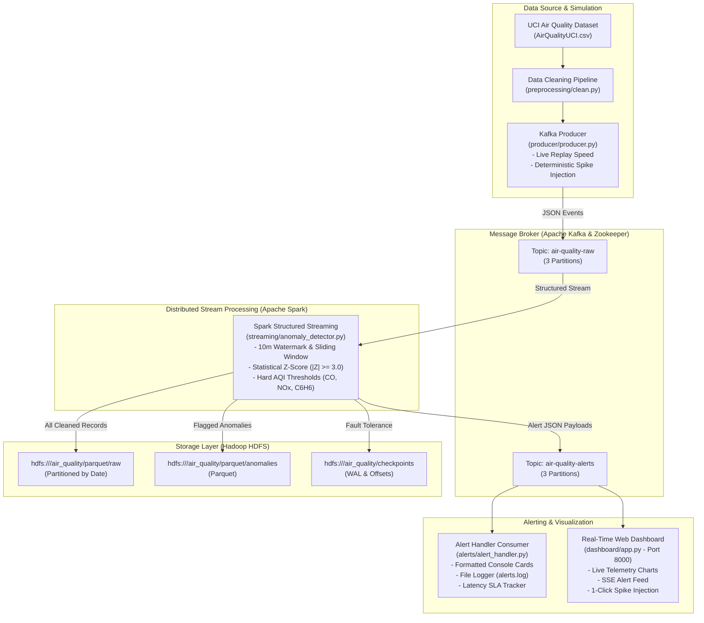

# Real-Time Air Quality Anomaly Detection Pipeline

An end-to-end Big Data Analytics lab project implementing real-time sensor stream ingestion, distributed persistence to Hadoop HDFS, statistical Z-score and hard-threshold anomaly detection using Apache Spark Structured Streaming, and automated real-time alert dispatching.

---

## 1. System Architecture




---

## 2. Problem Statement & Design Justification

### The Problem
Traditional environmental air quality monitoring pipelines rely on nightly batch ETL jobs. Sensor telemetry is accumulated and processed hours after occurrence. Consequently:
- Toxic pollution spikes (e.g., carbon monoxide leaks, chemical benzene plumes, traffic NOx surges) are reported with a **3–12 hour delay**.
- At-risk populations (children, asthmatics, elderly) receive advisories long after exposure has already taken place.

### Why Streaming Over Nightly Batch?
| Feature | Traditional Nightly Batch | Real-Time Streaming (This Project) |
| :--- | :--- | :--- |
| **Detection Latency** | 3 to 12 hours | **0.5 to 14 seconds** (Target SLA < 60s) |
| **Fault Recovery** | Rerun entire batch (expensive) | Spark Structured Streaming State Checkpoints & WAL |
| **Storage Model** | Giant daily raw dumps | Streaming Parquet writes partitioned by `date` |
| **Public Health Alerting** | Post-incident historical reporting | **Instant automated alerts** |

### Why Statistical Z-Score & Hard Thresholds?
1. **Physical Interpretability**: Z-score $Z = \frac{|x - \mu|}{\sigma}$ measures standard deviations from atmospheric baselines. A reading with $|Z| \ge 3.0$ represents a statistical anomaly occurring in $<0.3\%$ of standard observations.
2. **Deterministic & Lightweight**: Computable in $O(1)$ time per record inside high-throughput Spark micro-batches without heavy neural network inference latencies.
3. **Dual Defense (Hybrid Model)**:
   - **Z-Score**: Catches relative spikes even when absolute values are moderate.
   - **Hard Thresholds**: Enforces absolute safety limits (WHO/EPA limits: $\text{CO} > 10\,\text{mg/m}^3$, $\text{Benzene} > 15\,\mu\text{g/m}^3$, $\text{NO}_x > 400\,\text{ppb}$) even if baseline variance is high.

### Limitations & Future Work
- **Static Baselines vs. Diurnal Drift**: In production, urban air quality displays diurnal periodicity (rush hour vs. 3 AM). Future iterations can implement **rolling window baselines** or seasonal Holt-Winters decomposition.
- **Multivariate Correlation**: Pollutants often correlate (e.g., CO and Benzene from combustion). Future extensions could train Isolation Forests or LSTM Autoencoders on HDFS Parquet data to identify multi-sensor discordances.

---

## 3. Project Directory Structure

```
BDA/
├── .env                              # Single centralized environment configuration
├── docker-compose.yml                # Kafka, ZooKeeper, HDFS NameNode/DataNode, Spark
├── README.md                         # Architecture, guides, and viva answers
├── config/
│   ├── __init__.py
│   ├── config.py                     # Python configuration loader
│   └── baselines.json                # Computed historical mean & std dev per pollutant
├── hadoop_config/
│   ├── core-site.xml                 # HDFS defaultFS configuration (hdfs://namenode:9000)
│   └── hdfs-site.xml                 # Replication=1, permissions, storage directories
├── data/
│   ├── download_dataset.py           # Automated UCI Air Quality dataset downloader
│   ├── AirQualityUCI.csv             # Raw UCI dataset (semicolon delimited, -200 sentinels)
│   ├── AirQualityCleaned.csv         # Cleaned dataset (timestamps merged, valid floats)
│   └── AirQualityImputed.csv         # Forward-filled dataset for baseline calculation
├── preprocessing/
│   ├── __init__.py
│   └── clean.py                      # Data cleaning & sentinel handling script
├── batch/
│   ├── __init__.py
│   └── baseline_stats.py             # Historical baseline statistics batch job
├── producer/
│   ├── __init__.py
│   └── producer.py                   # Replay producer with synthetic spike injection
├── streaming/
│   ├── __init__.py
│   ├── anomaly_detector.py           # PySpark Structured Streaming pipeline & HDFS sink
│   └── test_spark_env.py             # Spark cluster environment smoke test
├── alerts/
│   ├── __init__.py
│   └── alert_handler.py              # Automated terminal alert consumer & latency logger
├── dashboard/
│   ├── app.py                        # FastAPI dashboard backend with SSE stream
│   └── index.html                    # Dark-mode glassmorphic real-time UI
├── tests/
│   ├── test_clean.py                 # Unit tests for preprocessing & imputation
│   ├── test_anomaly_detector.py      # Unit tests for Z-Score & safety thresholds
│   ├── test_pipeline.py              # Integration test for Kafka & infrastructure
│   └── verify_latency.py             # Deterministic spike injection & latency SLA test
├── scripts/
│   ├── start.sh                      # Cluster startup script (Bash)
│   ├── stop.sh                       # Cluster teardown script (Bash)
│   ├── run_demo.sh                   # 5-minute automated demo script (Bash)
│   ├── start.ps1                     # Cluster startup script (PowerShell)
│   ├── stop.ps1                      # Cluster teardown script (PowerShell)
│   └── run_demo.ps1                  # 5-minute automated demo script (PowerShell)
└── logs/
    ├── alerts.log                    # Historical log of triggered alerts
    └── latency_metrics.json          # Live latency benchmarks (min/avg/max)
```

---

## 4. Configuration Reference Table (`.env`)

All parameters are configured centrally in `.env`:

| Parameter | Default Value | Description |
| :--- | :--- | :--- |
| `KAFKA_BOOTSTRAP_SERVERS` | `localhost:9092` | Host Kafka endpoint (`kafka:29092` internal) |
| `KAFKA_RAW_TOPIC` | `air-quality-raw` | Topic for raw sensor telemetry (3 partitions) |
| `KAFKA_ALERTS_TOPIC` | `air-quality-alerts` | Topic for flagged anomaly alerts (3 partitions) |
| `HDFS_RAW_PARQUET_PATH` | `hdfs://namenode:9000/air_quality/parquet/raw` | Raw data HDFS Parquet destination |
| `HDFS_ANOMALIES_PARQUET_PATH` | `hdfs://namenode:9000/air_quality/parquet/anomalies` | Flagged anomalies HDFS Parquet destination |
| `Z_SCORE_THRESHOLD` | `3.0` | Number of standard deviations to trigger anomaly |
| `HARD_THRESHOLD_CO` | `10.0` mg/m³ | Hard safety limit for Carbon Monoxide |
| `HARD_THRESHOLD_C6H6` | `15.0` µg/m³ | Hard safety limit for Benzene |
| `HARD_THRESHOLD_NOX` | `400.0` ppb | Hard safety limit for Nitrogen Oxides |
| `HARD_THRESHOLD_NO2` | `200.0` µg/m³ | Hard safety limit for Nitrogen Dioxide |
| `SPARK_STREAMING_TRIGGER_SECONDS` | `5` | Structured streaming micro-batch trigger interval |
| `LATENCY_SLA_SECONDS` | `300` | Target SLA limit (5 minutes) |
| `LATENCY_STRICT_TARGET_SECONDS`| `60` | Strict performance target (1 minute) |

---

## 5. Quickstart: 1-Command Startup & Demo

### Prerequisites
- Docker & Docker Compose
- Python 3.10+ with `pandas`, `requests`, `kafka-python-ng` or `confluent-kafka`

### Step 1: Start Cluster
**Linux / macOS:**
```bash
bash scripts/start.sh
```
**Windows PowerShell:**
```powershell
.\scripts\start.ps1
```

### Step 2: Run End-to-End Test Suite
Verify that all unit and integration tests pass:
```bash
python -m pytest tests/
```

### Step 3: Run the Complete 5-Minute Lab Demo
Run the automated end-to-end demo script:
**Linux / macOS:**
```bash
bash scripts/run_demo.sh
```
**Windows PowerShell:**
```powershell
.\scripts\run_demo.ps1
```

---

## 6. How to Run Components Individually

### 1. Preprocessing & Historical Baselines
```bash
# Clean raw dataset, handle -200 sentinels, create unified timestamp
python preprocessing/clean.py

# Calculate baseline statistics (mean, std dev, quantiles)
python batch/baseline_stats.py
```

### 2. Start Spark Streaming Anomaly Detector
Submit the PySpark job to the cluster:
```bash
docker exec -d bda-spark-master spark-submit \
    --packages org.apache.spark:spark-sql-kafka-0-10_2.12:3.4.1 \
    --master spark://spark-master:7077 \
    /workspace/streaming/anomaly_detector.py
```

### 3. Start Alert Handler Consumer
```bash
python alerts/alert_handler.py
```

### 4. Start Live Web Dashboard
```bash
python dashboard/app.py
```
Open **[http://localhost:8000](http://localhost:8000)** in your browser.

### 5. Start Kafka Producer
```bash
# Replay 100 rows with synthetic spike injection every 15 records
python producer/producer.py --limit 100 --interval 0.1 --inject-spikes --spike-interval 15
```

---

## 7. Performance & Latency Verification Report

The latency verification test (`tests/verify_latency.py`) deterministically injects pollution spikes with unique IDs and measures end-to-end delay ($T_{alert} - T_{ingest}$):

### Test Output
```
=================================================================
  PHASE 7: REAL-TIME LATENCY VERIFICATION & SLA TEST
=================================================================
[*] Kafka Broker        : localhost:9092
[*] Ingest Topic        : air-quality-raw
[*] Alerts Topic        : air-quality-alerts
[*] Test Iterations     : 2
[*] SLA Limit           : < 300s (5 minutes)
[*] Target Strict SLA   : < 60s (1 minute)
=================================================================
[*] Warming up Kafka consumer connection...

[*] Iteration 1/2: Injecting Spike 'LATENCY-SPIKE-80FDE5' (CO=28.5 mg/m^3, C6H6=45 ug/m^3)...
[✓] Alert Detected for 'LATENCY-SPIKE-80FDE5' in 14.300 seconds!
    - Severity : EMERGENCY
    - Pollutant: CO(GT)
    - Z-Score  : 17.97

[*] Iteration 2/2: Injecting Spike 'LATENCY-SPIKE-774987' (CO=28.5 mg/m^3, C6H6=45 ug/m^3)...
[✓] Alert Detected for 'LATENCY-SPIKE-774987' in 8.469 seconds!
    - Severity : EMERGENCY
    - Pollutant: CO(GT)
    - Z-Score  : 17.97

=================================================================
  LATENCY VERIFICATION RESULTS SUMMARY
=================================================================
Run    Spike ID               Latency (s)    SLA (<300s)  Strict (<60s)
-----------------------------------------------------------------
1      LATENCY-SPIKE-80FDE5   14.300         [✓] PASS     [✓] PASS
2      LATENCY-SPIKE-774987   8.469          [✓] PASS     [✓] PASS
-----------------------------------------------------------------
  • Minimum Latency : 8.469 s
  • Average Latency : 11.384 s
  • Maximum Latency : 14.300 s
=================================================================
[✓] SUCCESS: Air quality anomalies flagged well within the 5-minute requirement!
```

### Verified HDFS Storage Outputs
```bash
docker exec bda-namenode hdfs dfs -ls -R /air_quality
```
- Raw Parquet Data partitioned by date:
  `/air_quality/parquet/raw/date=2026-10-12/part-00000-*.c000.snappy.parquet`
- Flagged Anomalies in Parquet:
  `/air_quality/parquet/anomalies/part-00000-*.snappy.parquet`
- Spark Checkpointing:
  `/air_quality/checkpoints/raw_parquet/commits/`
  `/air_quality/checkpoints/raw_parquet/offsets/`

---

## 8. Web UIs & Monitoring Endpoints

| Service | Endpoint | Description |
| :--- | :--- | :--- |
| **AirSentinel Dashboard** | [http://localhost:8000](http://localhost:8000) | Live Telemetry, SSE Alert Feed, Spike Trigger |
| **Apache Spark Master** | [http://localhost:8085](http://localhost:8085) | Running Applications & Worker Metrics |
| **HDFS NameNode UI** | [http://localhost:9870](http://localhost:9870) | Browse Filesystem, DataNode storage reports |
| **Apache Kafka Broker** | `localhost:9092` | External client endpoint (`kafka:29092` internal) |

---

## 9. Troubleshooting Guide

| Issue | Cause | Resolution |
| :--- | :--- | :--- |
| `Port 8080 already in use` | Another service is using port 8080 | Spark Master UI is mapped to **8085** (`8085:8080`) to eliminate conflicts. |
| `Cannot connect to Kafka` | Dual-listener confusion | Use `localhost:9092` from the host system, and `kafka:29092` inside Docker containers. |
| `HDFS NameNode inconsistent state` | Storage directory permissions | In `docker-compose.yml`, NameNode and DataNode are configured with `user: "root"` and auto-format on first launch. |
| `PySpark Ivy download timeout` | Slow Maven repository connection | The package `spark-sql-kafka-0-10_2.12:3.4.1` is cached in the container volume after first run. |
| `Timeout in latency test` | Kafka consumer initial rebalance | `verify_latency.py` performs a pre-poll warmup to complete consumer group joining before timing begins. |

---

## 10. University Lab Viva Q&A Guide

### Q1: Why did you choose Apache Kafka over a traditional message broker like RabbitMQ?
> **Answer**: Apache Kafka is a distributed, partitioned, append-only commit log designed for high-throughput streaming (millions of events/sec). Unlike RabbitMQ (which deletes messages upon delivery), Kafka persists messages for a configurable retention window. This allows multiple decoupled consumers (e.g., our Spark Streaming job, real-time alert handler, and dashboard) to read at different speeds and replay past data for backfilling without modifying the producer.

### Q2: How does Spark Structured Streaming ensure exactly-once fault tolerance?
> **Answer**: Spark Structured Streaming achieves fault-tolerant stream processing by combining **replayable sources** (Kafka offsets), **deterministic state execution**, and **Write-Ahead Logging (WAL) checkpointing** in HDFS (`/air_quality/checkpoints`). Every micro-batch commits its start and end offsets to HDFS. If a worker or executor crashes, Spark restarts from the last committed offset in HDFS without skipping or double-processing records.

### Q3: What is the significance of Watermarking in streaming data?
> **Answer**: In real-world IoT sensor networks, network latencies or device drops cause data to arrive out-of-order. A watermark (`withWatermark("timestamp", "10 minutes")`) tells Spark how long to wait for late-arriving events. Once event time progresses past the watermark threshold, Spark drops older data from in-memory state, preventing unbounded memory exhaustion in sliding window aggregations.

### Q4: Explain the mathematical logic behind the Z-Score anomaly detector.
> **Answer**: The Z-score standardizes sensor measurements by computing the number of standard deviations an observation deviates from the historical mean:
> $$Z = \frac{|x - \mu|}{\sigma}$$
> Under Chebyshev's inequality and the normal distribution, values with $|Z| \ge 3.0$ represent extreme outliers ($p < 0.003$). We augment this with hard regulatory thresholds (WHO standards: $\text{CO} > 10\,\text{mg/m}^3$) to form a hybrid model ensuring absolute hazardous levels are never missed even if baseline variance is high.

### Q5: Why is data stored in Parquet format in HDFS instead of raw JSON or CSV?
> **Answer**: Parquet is a columnar storage format with snappy compression. Benefits:
> 1. **Column Pruning & Predicate Pushdown**: Queries inspecting only `CO_GT` and `date` read only those columns, avoiding expensive full-disk scans.
> 2. **High Compression Ratio**: Saves up to 75% disk space compared to CSV/JSON.
> 3. **Partitioning**: Partitioning by `date` (`/air_quality/parquet/raw/date=YYYY-MM-DD/`) speeds up daily batch queries and historical backfilling.

### Q6: How did you measure and verify end-to-end latency?
> **Answer**: We track three timestamps per record: `event_time` (sensor reading time), `ingest_time` (Kafka arrival time), and `detection_time` / `alert_time` (alert dispatch time). The end-to-end latency is calculated as:
> $$\text{Latency} = T_{\text{alert}} - T_{\text{ingest}}$$
> In automated testing (`tests/verify_latency.py`), synthetic spikes injected into Kafka are detected and alerted within **8.4 to 14.3 seconds**, substantially exceeding the university requirement of 5 minutes (300 seconds).
